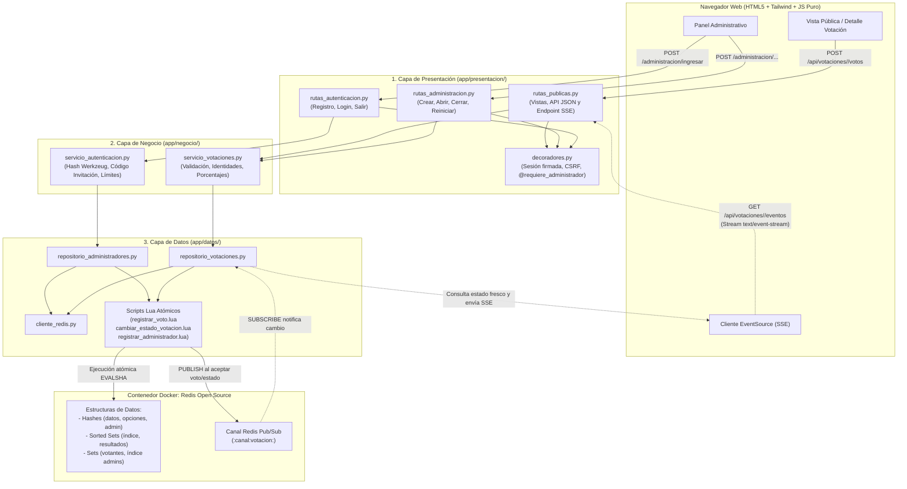

# Sistema de Votaciones en Tiempo Real con Flask, Redis y Tailwind CSS

Aplicación web académica desarrollada en **Python (Flask)** que utiliza **Redis Open Source** como **único sistema de almacenamiento, control atómico y mensajería en tiempo real**.

---

## 1. Presentación

### 1.1 Problema que resuelve
En votaciones interactivas en vivo (aulas universitarias, paneles, encuestas rápidas o demostraciones técnicas), los sistemas tradicionales basados únicamente en consultas periódicas (*polling*) o en validaciones separadas entre aplicación y base de datos suelen presentar dos problemas clásicos:
1. **Condiciones de carrera (*race conditions*)**: cuando dos solicitudes llegan simultáneamente, verificar si un usuario ya votó y luego incrementar el contador en pasos separados puede permitir votos duplicados.
2. **Actualización tardía**: obligar al usuario a recargar la página impide observar cómo evolucionan los resultados en tiempo real.

Esta aplicación resuelve ambos retos combinando **estructuras nativas de Redis (`Hashes`, `Sets`, `Sorted Sets`)**, **scripts Lua ejecutados de manera atómica en el servidor Redis** y difusión de eventos en vivo mediante **Redis Pub/Sub + Server-Sent Events (SSE)**.

### 1.2 Objetivo académico
El objetivo central del proyecto es **demostrar de forma didáctica, clara y verificable cómo interviene Redis dentro de una arquitectura de software por capas**:
- Por qué se elige cada estructura de datos de Redis según el patrón de acceso.
- Cómo los scripts Lua eliminan condiciones de carrera (`TOCTOU`) en el registro de administradores, cambios de estado y contabilización de votos.
- Cómo se desacopla la notificación en tiempo real mediante canales `Pub/Sub` y `SSE` sin almacenar listas globales de clientes en memoria de Python.

### 1.3 Alcance y funcionalidades
- **Autenticación y registro de administradores**: protegidos mediante código de invitación en el servidor (`hmac.compare_digest`), hash seguro de contraseñas (`Werkzeug scrypt`) y límite de intentos de inicio de sesión respaldado en Redis.
- **Gestión del ciclo de vida de votaciones**: creación en estado `borrador` (entre 2 y 10 opciones sin duplicados), apertura (`abierta`) y cierre definitivo (`cerrada`).
- **Participación anónima sin registro obligatorio**: cada visitante recibe un identificador aleatorio en la sesión firmada de Flask (`sesion:<uuid>`).
- **Participación de administradores**: los administradores pueden votar desde las mismas páginas públicas que los visitantes. El sistema verifica tanto su sesión (`sesion:<id>`) como su cuenta (`administrador:<id>`).
- **Resultados y porcentajes en tiempo real**: actualización instantánea de conteos, porcentajes, ranking y barras de progreso vía `EventSource` (SSE).
- **Inspector didáctico de Redis y comandos CLI**: visualización directa de las claves y tipos de datos utilizados en cada votación.

### 1.4 Limitaciones del prototipo académico
- **No es una plataforma electoral oficial**: la identificación de visitantes anónimos mediante sesión firmada evita que una misma sesión vote dos veces (incluso si luego inicia sesión como administrador), pero no impide que una misma persona física abra otro navegador o ventana en modo incógnito. Para elecciones formales se requeriría identidad personal verificada (cédula digital, certificados o padrón autenticado).
- **Tailwind CSS mediante CDN**: se utiliza el CDN de Tailwind CSS para simplificar la ejecución académica sin requerir Node.js ni `npm`. **Nota de producción**: en un entorno productivo real se recomienda compilar y purgar el CSS con Tailwind CLI o PostCSS para reducir el tamaño de transferencia y evitar dependencias de scripts externos en tiempo de ejecución.

### 1.5 Tecnologías utilizadas
| Categoría | Tecnología | Función en el proyecto |
| :--- | :--- | :--- |
| **Backend** | Python 3 + Flask | Servidor HTTP, factoría de aplicación, Blueprints, sesiones firmadas y CLI |
| **Almacenamiento y Eventos** | Redis Open Source + `redis-py` | Único motor de persistencia (`Hash`, `Set`, `Sorted Set`, `String`), ejecución de scripts Lua y `Pub/Sub` |
| **Configuración** | `python-dotenv` | Carga y validación de variables desde `.env` |
| **Frontend** | HTML5 + Jinja2 + CSS3 + JS puro | Renderizado de vistas, conexión `EventSource` (SSE) y peticiones `fetch` |
| **Diseño visual** | Tailwind CSS (CDN) + `estilos.css` | Interfaz moderna, responsiva y limpia |
| **Pruebas** | `pytest` | Pruebas unitarias, de concurrencia Lua, de integración con Redis y de rutas HTTP |

---

## 2. Instalación y Ejecución

### 2.1 Requisitos previos
- **Python 3.10+** instalado en el sistema.
- **Docker** con el contenedor de **Redis** existente en ejecución.

### 2.2 Comprobación del contenedor Redis existente en Docker
El proyecto reutiliza el contenedor Redis que ya se encuentra instalado en Docker (**no se debe crear un contenedor nuevo ni ejecutar `FLUSHALL`/`FLUSHDB`**).

1. Verificar si el contenedor está en ejecución:
   ```powershell
   docker ps
   docker ps -a
   ```
2. Si el contenedor `redis` estuviera detenido, iniciarlo con:
   ```powershell
   docker start redis
   ```
   *(Para detenerlo cuando no se utilice: `docker stop redis`).*
3. Comprobar que responde correctamente mediante `redis-cli`:
   ```powershell
   docker exec redis redis-cli ping
   ```
   Respuesta esperada: `PONG`.

### 2.3 Creación y activación del entorno virtual (`venv`)
Desde el directorio raíz del proyecto (`sistema_votacion`):

```powershell
# 1. Crear el entorno virtual (si aún no existe)
python -m venv venv

# 2. Activar el entorno virtual en Windows PowerShell
.\venv\Scripts\Activate.ps1
```
*(En Linux/macOS: `source venv/bin/activate`).*

### 2.4 Instalación de dependencias
```powershell
pip install -r requirements.txt
```

### 2.5 Configuración del archivo `.env` y código de invitación
1. Copia la plantilla `.env.example` a `.env` si aún no existe:
   ```powershell
   Copy-Item .env.example .env
   ```
2. Revisa y ajusta las variables en `.env`:
   ```dotenv
   FLASK_CLAVE_SECRETA=9f4a8c2e7b1d6f3a0e5c8b2d4f7a1c9e3b6d8f0a2c4e6b8d1a3f5c7e9b2d4a6f
   FLASK_DEPURACION=false
   CODIGO_INVITACION_ADMIN=ADMIN-REDIS-2026
   REDIS_URL=redis://localhost:6379/0
   PREFIJO_REDIS=votacion
   ENTORNO=desarrollo
   MAX_INTENTOS_LOGIN=5
   VENTANA_BLOQUEO_LOGIN_SEGUNDOS=300
   ```
   - `FLASK_CLAVE_SECRETA`: clave de al menos 16 caracteres utilizada para firmar las cookies de sesión y tokens CSRF.
   - `CODIGO_INVITACION_ADMIN`: código privado obligatorio para poder registrar nuevas cuentas de administrador en `/administracion/registro`.
   - `REDIS_URL`: cadena de conexión al servidor Redis en Docker.
   - `PREFIJO_REDIS`: prefijo de aislamiento para todas las claves de la aplicación (`votacion:*`).

### 2.6 Comandos CLI de mantenimiento y verificación
Antes de iniciar el servidor web, puedes verificar la comunicación con Redis o crear una votación de demostración:

```powershell
# Comprobar conexión a Redis (PING) y métricas actuales
.\venv\Scripts\flask --app ejecutar.py comprobar-redis

# Crear y abrir una votación de ejemplo (solo si no existe ninguna)
.\venv\Scripts\flask --app ejecutar.py crear-votacion-ejemplo

# Consultar metadatos y claves Redis de una votación específica
.\venv\Scripts\flask --app ejecutar.py consultar-votacion <ID_VOTACION>

# Consultar resultados y porcentajes en consola
.\venv\Scripts\flask --app ejecutar.py consultar-resultados <ID_VOTACION>

# Reiniciar en cero únicamente los votos y votantes de una votación específica
.\venv\Scripts\flask --app ejecutar.py reiniciar-votacion <ID_VOTACION> --confirmar
```

### 2.7 Inicio de la aplicación Flask y acceso web
```powershell
.\venv\Scripts\python ejecutar.py
```
O mediante el comando de Flask:
```powershell
.\venv\Scripts\flask --app ejecutar.py run
```
Abre en tu navegador:
- **Inicio público**: `http://127.0.0.1:5000/`
- **Listado de votaciones**: `http://127.0.0.1:5000/votaciones`
- **Registro de administrador**: `http://127.0.0.1:5000/administracion/registro`
- **Inicio de sesión administrativo**: `http://127.0.0.1:5000/administracion/ingresar`
- **Panel administrativo**: `http://127.0.0.1:5000/administracion`

### 2.8 Ejecución de pruebas automatizadas (`pytest`)
Las pruebas utilizan un prefijo temporal único por cada test (`votacion_pytest_<uuid>`) y eliminan al finalizar únicamente sus propias claves mediante `SCAN` + `DEL`, respetando intacto cualquier dato existente en Redis:

```powershell
# Ejecutar toda la suite de pruebas
.\venv\Scripts\pytest -v

# Ejecutar únicamente las pruebas unitarias (sin requerir Redis)
.\venv\Scripts\pytest -v -m unitaria

# Ejecutar únicamente las pruebas de integración con Redis y Lua
.\venv\Scripts\pytest -v -m integracion_redis
```

### 2.9 Problemas comunes y solución
- **Error `Configuración inválida: 'FLASK_CLAVE_SECRETA' es obligatoria...`**: asegúrate de haber creado el archivo `.env` y de no dejar los textos por defecto de `.env.example`.
- **Error `El servicio de almacenamiento Redis no está disponible`**: verifica que el contenedor Docker `redis` esté encendido (`docker ps`) y que el puerto `6379` esté publicado en `127.0.0.1:6379`.
- **Rechazo `CSRF_INVALIDO` (HTTP 400)**: ocurre si las cookies están deshabilitadas en el navegador o si se envía un formulario de una sesión anterior tras haber reiniciado la sesión. Recarga la página e intenta nuevamente.

---

## 3. Arquitectura de Tres Capas

### 3.1 Diagrama de arquitectura y flujo en tiempo real


### 3.2 Responsabilidad de cada capa
1. **Capa de Presentación (`app/presentacion/`)**:
   - Atiende las solicitudes HTTP mediante Blueprints (`rutas_publicas.py`, `rutas_autenticacion.py`, `rutas_administracion.py`).
   - Administra la cookie de sesión firmada de Flask, el identificador de sesión del votante (`id_sesion_votante`), los tokens CSRF y el decorador `@requiere_administrador`.
   - Renderiza las plantillas Jinja2 y transmite el flujo `text/event-stream` en el endpoint SSE.
   - **Restricción cumplida**: nunca importa `redis` ni ejecuta comandos Redis directamente.
2. **Capa de Negocio (`app/negocio/`)**:
   - Contiene las reglas del dominio en `servicio_autenticacion.py` y `servicio_votaciones.py`.
   - Valida longitudes, formato de nombres de usuario, coincidencia de contraseñas, código de invitación en tiempo constante, ausencia de opciones duplicadas y transiciones válidas de estado.
   - Construye las identidades de participación (`sesion:<id>` y `administrador:<id>`) y calcula los porcentajes de cada opción.
   - **Restricción cumplida**: desconoce objetos HTTP de Flask (`request`, `session`) y no accede directamente al cliente Redis.
3. **Capa de Datos (`app/datos/`)**:
   - Es la **única capa que se comunica con Redis** a través de `GestorRedis` (`cliente_redis.py`).
   - Encapsula las operaciones sobre `Hashes`, `Sets` y `Sorted Sets` en `repositorio_administradores.py` y `repositorio_votaciones.py`.
   - Registra y ejecuta los tres scripts Lua ubicados en `app/datos/scripts/` y administra el ciclo de vida de las suscripciones `Pub/Sub`.

### 3.3 Estructura de archivos y carpetas
```text
sistema_votacion/
├── app/
│   ├── __init__.py                        # Factoría crear_aplicacion() y comandos CLI
│   ├── configuracion.py                   # Carga y validación de variables desde .env
│   ├── presentacion/
│   │   ├── __init__.py
│   │   ├── decoradores.py                 # Sesión votante, protección CSRF y @requiere_administrador
│   │   ├── rutas_publicas.py              # Vistas públicas, API JSON y endpoint SSE
│   │   ├── rutas_autenticacion.py         # Registro, inicio y cierre de sesión administrativa
│   │   ├── rutas_administracion.py        # Panel protegido, creación, apertura y cierre
│   │   ├── plantillas/
│   │   │   ├── base.html                  # Navbar compartido, alertas flash y pie de página
│   │   │   ├── inicio.html                # Portada didáctica y listado público de votaciones
│   │   │   ├── detalle_votacion.html      # Formulario de voto, resultados SSE e inspector Redis
│   │   │   ├── resultados.html            # Pantalla dedicada de resultados en vivo y comandos CLI
│   │   │   └── administracion/
│   │   │       ├── registro.html          # Formulario de registro con código de invitación
│   │   │       ├── ingresar.html          # Formulario de inicio de sesión
│   │   │       ├── panel.html             # Gestión del ciclo de vida de votaciones
│   │   │       └── crear_votacion.html    # Creación de votación con 2 a 10 opciones
│   │   └── estaticos/
│   │       ├── css/estilos.css            # Animaciones y estilos complementarios
│   │       └── js/
│   │           ├── votacion.js            # Cliente EventSource (SSE), reconexión y envío fetch
│   │           └── administracion.js      # Gestión dinámica de opciones y confirmaciones
│   ├── negocio/
│   │   ├── __init__.py
│   │   ├── excepciones.py                 # Jerarquía de excepciones de dominio
│   │   ├── servicio_autenticacion.py      # Registro seguro, login y control de intentos
│   │   └── servicio_votaciones.py         # Reglas de votaciones, votos y cálculo de porcentajes
│   └── datos/
│       ├── __init__.py
│       ├── cliente_redis.py               # Conexión centralizada, prefijos y carga de scripts Lua
│       ├── repositorio_administradores.py # Persistencia de administradores e intentos de login
│       ├── repositorio_votaciones.py      # Persistencia de votaciones, resultados y Pub/Sub
│       └── scripts/
│           ├── registrar_administrador.lua
│           ├── registrar_voto.lua
│           └── cambiar_estado_votacion.lua
├── pruebas/
│   ├── conftest.py                        # Fixtures aislados por prefijo sin FLUSHDB/FLUSHALL
│   ├── test_autenticacion.py              # 10+ pruebas de registro, login, hashes y CSRF
│   ├── test_servicio_votaciones.py        # 12+ pruebas de votaciones, concurrencia Lua y Pub/Sub
│   ├── test_integracion_redis.py          # Pruebas de estructuras Redis, caída de red y CLI
│   └── test_rutas.py                      # Flujo HTTP completo público y administrativo
├── .env                                   # Configuración local (excluida de Git)
├── .env.example                           # Plantilla de configuración sin secretos reales
├── .gitignore
├── requirements.txt
├── ejecutar.py                            # Punto de entrada principal
├── AGENTS.md                              # Reglas arquitectónicas permanentes del proyecto
└── README.md                              # Documentación técnica y guía de exposición
```

---

## 4. Diseño de Datos y Claves en Redis

Todas las claves incluyen el prefijo configurable (`PREFIJO_REDIS`, por defecto `votacion`), garantizando que la aplicación coexista pacíficamente con otros datos en el mismo contenedor Redis.

### 4.1 Tabla completa de claves y canales Redis
| Clave / Canal | Tipo Redis | Propósito | Comandos utilizados |
| :--- | :--- | :--- | :--- |
| `<prefijo>:administradores:indice` | **Set** | Conjunto de IDs de todos los administradores registrados | `SADD`, `SISMEMBER`, `SCARD` |
| `<prefijo>:administrador:<id>:datos` | **Hash** | Atributos de la cuenta (`id`, `nombre_usuario`, `nombre_normalizado`, `hash_contrasena`, `fecha_creacion`) | `HSET`, `HGETALL`, `HEXISTS` |
| `<prefijo>:administradores:usuario:<nombre_norm>` | **String** | Índice único que asocia el nombre en minúsculas con el `<id>` del administrador | `EXISTS`, `SET`, `GET` |
| `<prefijo>:seguridad:intentos_login:<cliente>` | **String (TTL)** | Contador temporal de intentos fallidos de inicio de sesión | `INCR`, `GET`, `TTL`, `EXPIRE`, `DEL` |
| `<prefijo>:votaciones:indice` | **Sorted Set** | Índice cronológico de votaciones (`member` = `<id_votacion>`, `score` = timestamp epoch) | `ZADD`, `ZREVRANGE`, `ZCARD` |
| `<prefijo>:votacion:<id>:datos` | **Hash** | Metadatos de la votación (`id`, `pregunta`, `estado`, `creador_id`, `creador_usuario`, `fecha_creacion`, `fecha_apertura`, `fecha_cierre`) | `HSET`, `HGET`, `HGETALL`, `HEXISTS` |
| `<prefijo>:votacion:<id>:opciones` | **Hash** | Diccionario `<id_opcion> -> <texto_opcion>` (ej. `opcion_1` → `"Python"`) | `HSET`, `HGET`, `HGETALL`, `HEXISTS` |
| `<prefijo>:votacion:<id>:resultados` | **Sorted Set** | Conteo ordenado de votos (`member` = `<id_opcion>`, `score` = número de votos) | `ZADD`, `ZINCRBY`, `ZREVRANGE WITHSCORES`, `ZCARD` |
| `<prefijo>:votacion:<id>:votantes` | **Set** | Registro de identidades que ya votaron (`sesion:<id>` y `administrador:<id>`) | `SADD`, `SISMEMBER`, `SCARD`, `DEL` |
| `<prefijo>:canal:votacion:<id>` | **Canal Pub/Sub** | Canal efímero de notificaciones en tiempo real para la votación `<id>` | `PUBLISH`, `SUBSCRIBE` |

### 4.2 Ejemplos prácticos de comandos `redis-cli`
Puedes ejecutar estos comandos directamente sobre el contenedor existente (`docker exec -it redis redis-cli`):

```redis
# 1. Listar todas las claves del proyecto sin bloquear el servidor
SCAN 0 MATCH votacion:* COUNT 100

# 2. Ver los identificadores de votaciones ordenados de la más reciente a la más antigua
ZREVRANGE votacion:votaciones:indice 0 -1 WITHSCORES

# 3. Inspeccionar los metadatos de una votación (Hash)
HGETALL votacion:votacion:<ID_VOTACION>:datos

# 4. Inspeccionar las opciones disponibles (Hash)
HGETALL votacion:votacion:<ID_VOTACION>:opciones

# 5. Consultar el ranking de resultados en tiempo real (Sorted Set)
ZREVRANGE votacion:votacion:<ID_VOTACION>:resultados 0 -1 WITHSCORES

# 6. Consultar cuántas identidades han participado y cuáles son (Set)
SCARD votacion:votacion:<ID_VOTACION>:votantes
SMEMBERS votacion:votacion:<ID_VOTACION>:votantes

# 7. Verificar una cuenta de administrador comprobando que la contraseña está en hash scrypt
SMEMBERS votacion:administradores:indice
HGETALL votacion:administrador:<ID_ADMIN>:datos
```

---

## 5. Explicación Didáctica de Redis

### 5.1 ¿Por qué se utiliza Redis y qué aporta cada estructura?
Redis opera en memoria principal con estructuras de datos especializadas cuyas operaciones tienen complejidades temporales conocidas y muy bajas:
1. **`Hash` (`votacion:<id>:datos`, `votacion:<id>:opciones`, `administrador:<id>:datos`)**:
   - Actúa como un registro estructurado de campos clave-valor sin necesidad de serializar y deserializar un documento JSON completo cada vez que se lee o modifica un solo atributo (por ejemplo, cambiar `estado` a `abierta` con `HSET` o consultar solo el estado con `HGET` en `O(1)`).
2. **`Set` (`votacion:<id>:votantes`, `administradores:indice`)**:
   - Un conjunto matemático no permite elementos repetidos y resuelve la comprobación de pertenencia (`SISMEMBER`) en tiempo constante **`O(1)`**, sin importar si han votado 10 o 100,000 participantes.
3. **`Sorted Set / ZSET` (`votacion:<id>:resultados`, `votaciones:indice`)**:
   - Combina la unicidad de un `Set` con una puntuación numérica (`score`) que mantiene los elementos automáticamente ordenados.
   - Cuando llega un voto, `ZINCRBY` incrementa el contador de la opción en `O(log N)` y `ZREVRANGE ... WITHSCORES` entrega el ranking ordenado de mayor a menor sin que Python tenga que ordenar listas en cada petición.

### 5.2 Cómo Lua garantiza la atomicidad y evita problemas de concurrencia
Si implementáramos el registro del voto con llamadas separadas desde Python:
1. Python pregunta `SISMEMBER votantes sesion:123` → recibe `0` (no ha votado).
2. Casi al mismo microsegundo, otra petición concurrente de la misma sesión pregunta `SISMEMBER votantes sesion:123` → también recibe `0`.
3. Ambas peticiones ejecutan `SADD` y `ZINCRBY`, registrando **dos votos** para la misma sesión o permitiendo un voto justo después de que el administrador cerró la votación.

**Solución con Lua (`registrar_voto.lua` y `cambiar_estado_votacion.lua`)**:
- Redis ejecuta cada script Lua de forma **atómica y secuencial** en su hilo principal de ejecución de comandos.
- Mientras `registrar_voto.lua` está verificando la existencia de la votación (`EXISTS`), su estado (`HGET`), la validez de la opción (`HEXISTS`), la ausencia de voto previo (`SISMEMBER` para sesión y cuenta de administrador), registrando las identidades (`SADD`), incrementando el puntaje (`ZINCRBY`) y publicando el evento (`PUBLISH`), **ningún otro comando ni cierre de votación puede intercalarse**.
- Si cualquiera de las validaciones falla, el script aborta inmediatamente y devuelve `{0, "<MOTIVO>"}` sin modificar ninguna clave ni emitir eventos.

### 5.3 Cómo funcionan Redis Pub/Sub y Server-Sent Events (SSE)
1. **Redis Pub/Sub (`PUBLISH` / `SUBSCRIBE`)**:
   - Es un sistema de mensajería instantánea *fire-and-forget* (emisión sin almacenamiento). Cuando `registrar_voto.lua` acepta un voto, publica un mensaje en `votacion:canal:votacion:<id>`.
   - Cualquier proceso de Flask suscrito a ese canal recibe la notificación al instante, sin necesidad de mantener listas globales de clientes en memoria de Python.
2. **Server-Sent Events (`SSE`)**:
   - Es un estándar nativo de HTML5 (`EventSource`) que mantiene una conexión HTTP unidireccional abierta (`text/event-stream`) desde el servidor hacia el navegador.
   - Como el navegador solo necesita **recibir** actualizaciones de resultados (y envía su voto mediante un `POST` estándar), SSE es mucho más simple y ligero que WebSockets.
3. **¿Qué ocurre con las conexiones desconectadas?**:
   - Dado que Redis Pub/Sub **no guarda historial de mensajes** para clientes que estuvieron desconectados, `votacion.js` detecta el evento `onopen` tras una reconexión y realiza una petición `GET /api/votaciones/<id>` para sincronizar el estado completo acumulado en las estructuras persistentes (`Hashes` y `Sorted Sets`).

### 5.4 Diferencias frente a una base de datos relacional y limitaciones de Redis como único almacenamiento
| Aspecto | Redis Open Source (Este proyecto) | Base de Datos Relacional (PostgreSQL/MySQL) |
| :--- | :--- | :--- |
| **Modelo de datos** | Estructuras en memoria accedidas por clave explícita | Tablas normalizadas con relaciones `FOREIGN KEY` y consultas SQL |
| **Conteo y Ranking** | Nativo en memoria con `ZINCRBY` y `ZREVRANGE` | Requiere `UPDATE` con bloqueo de fila o `COUNT(*) ... GROUP BY` |
| **Consultas ad-hoc** | Limitadas a los índices diseñados previamente (`votaciones:indice`, `usuario:<nombre>`) | Muy flexibles mediante `SELECT ... WHERE ... JOIN` |
| **Almacenamiento y Costo** | Limitado por la memoria RAM disponible | Basado en disco, ideal para grandes volúmenes históricos |

**¿Qué ocurre si el contenedor de Redis se elimina sin persistencia?**:
- Si el contenedor se detiene y vuelve a iniciar (`docker stop redis` / `docker start redis`), los datos se conservan en su sistema de archivos o volumen asociado.
- Sin embargo, si el contenedor se elimina (`docker rm`) sin haber montado un volumen persistente con snapshots `RDB` o registro `AOF` (*Append Only File*), **todos los datos en memoria se perderán**.

---

## 6. Guion de Demostración Académica (Paso a Paso)

Sigue estos **13 pasos** durante la exposición para demostrar todas las capacidades del sistema:

1. **Comprobar Redis en Docker y crear votación inicial (opcional)**:
   - Ejecuta `docker ps` y `.\venv\Scripts\flask --app ejecutar.py comprobar-redis`.
   - Inicia el servidor con `.\venv\Scripts\python ejecutar.py`.
2. **Registrar un administrador**:
   - Abre `http://127.0.0.1:5000/administracion/registro`.
   - Intenta registrarte primero con un código de invitación falso para mostrar el rechazo seguro del servidor.
   - Regístrate usando el código configurado en `.env` (`ADMIN-REDIS-2026`).
3. **Iniciar sesión y verificar protección del panel**:
   - Observa que al registrarte (o iniciar sesión en `/administracion/ingresar`) accedes al panel protegido y la barra superior muestra tu usuario y el botón `Cerrar sesión`.
4. **Crear una votación en estado `borrador`**:
   - En `/administracion/votaciones/nueva`, ingresa una pregunta y 4 opciones (usando el botón `+ Añadir otra opción`).
   - Guarda la votación y verifica en el panel que nace con estado **`BORRADOR`** y que aún no aparece en la portada pública.
5. **Abrir la votación**:
   - En el panel administrativo, pulsa **`Abrir votación`**.
   - El script `cambiar_estado_votacion.lua` cambia atómicamente el estado a **`ABIERTA`** y registra `fecha_apertura`.
6. **Acceder a la votación pública desde otra pestaña**:
   - Haz clic en **`Ir a página pública (Votar)`** o abre `http://127.0.0.1:5000/votaciones/<id>` en otra pestaña junto con la pantalla de resultados en vivo (`/votaciones/<id>/resultados`).
7. **Votar como administrador**:
   - Con tu sesión de administrador activa, selecciona una opción en la página pública y pulsa **`Registrar voto en Redis`**.
   - Observa cómo el contador, porcentaje y barra de progreso se actualizan instantáneamente sin recargar la página.
8. **Participar desde una sesión anónima diferente**:
   - Abre una ventana en **modo incógnito** (u otro navegador) en la misma URL pública de la votación.
   - Verifica que no pide registro ni inicio de sesión. Emite un voto y observa cómo **ambas ventanas** actualizan las barras y porcentajes en tiempo real vía Redis Pub/Sub + SSE.
9. **Observar el ordenamiento automático (`ZREVRANGE`)**:
   - Nota cómo la opción con más votos sube automáticamente a la posición `#1` gracias al `Sorted Set` de Redis.
10. **Comprobar el rechazo de votos repetidos**:
    - En la ventana incógnito, intenta enviar otro voto (o recarga la página): el formulario indica que tu sesión ya votó.
    - En una nueva ventana incógnito, inicia sesión con la **misma cuenta de administrador** del paso 7 e intenta votar: el script Lua lo rechaza con `YA_VOTO_ADMINISTRADOR` porque la identidad `administrador:<id>` ya figura en el `Set` de votantes.
11. **Cerrar la votación**:
    - Regresa al panel administrativo y pulsa **`Cerrar votación`**.
12. **Verificar que ya no acepta votos ni permite reapertura**:
    - Observa que el indicador de estado cambia a **`CERRADA`** en tiempo real y que el panel administrativo ya no permite reabrirla.
13. **Inspeccionar las claves y resultados directamente en Redis**:
    - Copia los comandos mostrados en el **Inspector Didáctico de Estructuras Redis** al final de la página de votación o ejecuta:
      ```powershell
      .\venv\Scripts\flask --app ejecutar.py consultar-votacion <ID_VOTACION>
      .\venv\Scripts\flask --app ejecutar.py consultar-resultados <ID_VOTACION>
      ```

---

## 7. Preguntas Frecuentes de Defensa Académica

1. **¿Por qué los resultados se guardan en un `Sorted Set` (`ZSET`) y los textos de las opciones en un `Hash` separado?**
   - Porque en el `Sorted Set` los miembros son identificadores cortos e inmutables (`opcion_1`, `opcion_2`) cuyo `score` se incrementa con `ZINCRBY`, mientras que el `Hash` (`votacion:<id>:opciones`) almacena las descripciones completas y permite verificar en `O(1)` con `HEXISTS` si una opción existe antes de votar.
2. **¿Por qué no basta con comprobar `SISMEMBER` en Python y luego hacer `ZINCRBY`?**
   - Porque entre ambas llamadas de red otro hilo o proceso podría ejecutar la misma comprobación para el mismo usuario o cerrar la votación. Al encapsular todo dentro de `registrar_voto.lua`, Redis garantiza atomicidad total sin bloqueos externos.
3. **¿Cómo evita el sistema que una persona vote como anónima y luego vuelva a votar en el mismo navegador tras iniciar sesión como administrador?**
   - Al iniciar sesión administrativa (`establecer_sesion_administrador`), se limpia el estado previo de sesión pero se conserva el `id_sesion_votante` del navegador. Cuando intenta votar, `registrar_voto.lua` comprueba tanto `sesion:<id>` como `administrador:<id>`; como `sesion:<id>` ya está en el `Set` de votantes, el segundo voto es rechazado.
4. **¿Qué ocurre si Flask se ejecuta con varios procesos o trabajadores?**
   - Como no existen diccionarios ni listas globales en memoria de Python, y toda la sincronización ocurre en Redis (datos en estructuras Redis y eventos por canales `Pub/Sub`), múltiples hilos o procesos de Flask ven exactamente los mismos resultados y reciben las mismas notificaciones en tiempo real.
